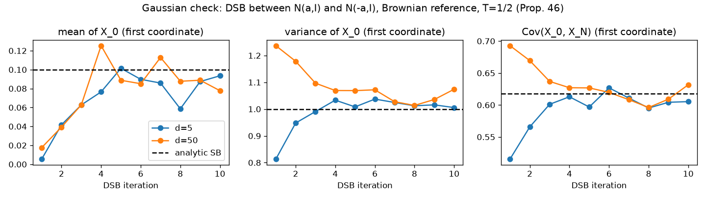
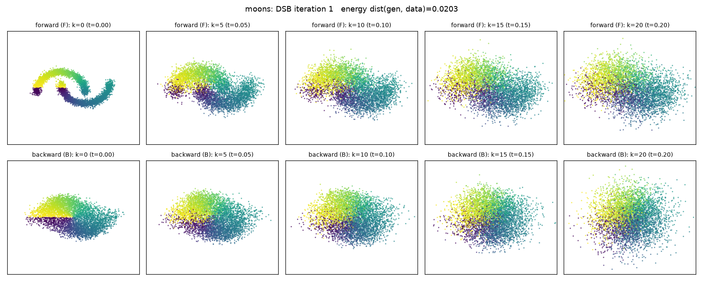
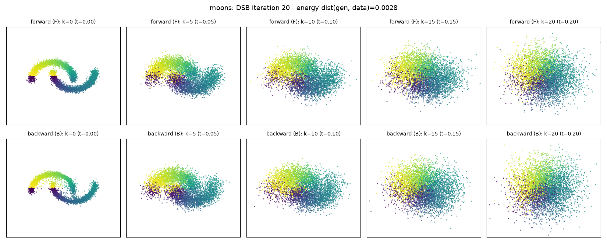
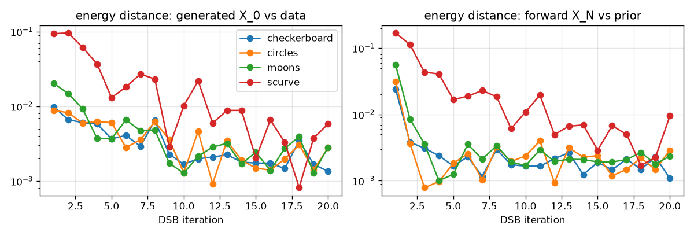

# Diffusion Schrödinger Bridge in JAX + Equinox

Implementation of **Algorithm 1 (Diffusion Schrödinger Bridge, DSB)** from

> De Bortoli, Thornton, Heng, Doucet. *Diffusion Schrödinger Bridge with Applications to
> Score-Based Generative Modeling.* NeurIPS 2021 ([arXiv:2106.01357](https://arxiv.org/abs/2106.01357), included as `2106.01357v5.pdf`).

together with the practical variants of Appendix I (closed-form sampling for the first
iteration, cached trajectories = Algorithm 3, warm starts, EMA), demonstrated on a Gaussian
case with a known analytic solution, on 2-D toys, and on **CIFAR-10**.

## What the algorithm does

Score-based generative models (SGMs) noise data with a forward SDE for a long time T so that
the final marginal is close to a Gaussian prior, then learn the time reversal.  DSB instead
solves the *Schrödinger bridge* problem — find the path measure closest (in KL) to the
reference noising process whose marginals are *exactly* `p_data` at time 0 and `p_prior` at
time T — with Iterative Proportional Fitting (IPF).  Each IPF half-step is a regression:

* **backward half-step (eq. 12):** simulate the current forward chain from data,
  `X_{k+1} = F^n(k, X_k) + sqrt(2 γ_{k+1}) Z`, and fit the backward mean map
  `B^n(k+1, X_{k+1}) ≈ X_{k+1} + F^n(k, X_k) − F^n(k, X_{k+1})`;
* **forward half-step (eq. 13):** simulate the backward chain from the prior,
  `X_{k−1} = B^n(k, X_k) + sqrt(2 γ_k) Z`, and fit the forward mean map
  `F^{n+1}(k, X_k) ≈ X_k + B^n(k+1, X_{k+1}) − B^n(k+1, X_k)`.

The first backward half-step (with the reference drift `F^0(k,x) = x − γ α (x − m)`) *is*
classical SGM training; every further iteration corrects the mismatch between the forward
chain's endpoint and the prior, so that a short horizon T and few steps N suffice.  Sampling
runs the learnt backward chain from `p_prior`.

## Code map

| file | content |
|---|---|
| `dsb/schedule.py` | symmetric γ schedule (App. J.2), OU/Brownian reference dynamics, closed-form reference marginals (Technique 2) |
| `dsb/networks.py` | Equinox networks returning the *increment* `mean − x`: `ToyMLP` (Fig. 9) and a reduced Nichol–Dhariwal `UNet` (64 channels, ~9M params) |
| `dsb/ipf.py` | trajectory simulation with `lax.scan`, Prop. 3 regression targets, trajectory cache (Alg. 3), mean-matching loss, Adam + EMA train step |
| `dsb/train.py` | the IPF loop of Algorithm 1: alternating half-steps, cache refreshes, warm starts, checkpoints/resume, evaluation hooks |
| `dsb/data.py` | CIFAR-10 loader (uint8 on device, random flips), 2-D toy datasets |
| `scripts/train_gaussian.py` | analytic check (Prop. 46): DSB between N(a,I) and N(−a,I) must give Cov(X_0,X_N) = (√5−1)/2 |
| `scripts/train_toy.py` | 2-D experiments with a short horizon (T = 0.2), Figure 1/3-style plots |
| `scripts/train_cifar.py` | CIFAR-10 experiment (App. J.2 configuration), sample grids, trajectory strips, sample dumps for FID |
| `scripts/fid.py` | FID per DSB iteration (torch CPU venv `.venv-fid`, pytorch-fid Inception) |
| `slurm/` | `run.sbatch` (1 GPU) and `cpu.sbatch` runners, toy suite |

## Running on the cluster

```bash
mkdir -p logs                                                # Slurm needs it before submission
sbatch --job-name=cifar --time=20:00:00 --gres=gpu:a100:1 slurm/run.sbatch \
    python scripts/train_cifar.py --outdir runs/cifar10_N50 --num-steps 50 --iters 10 --steps 5000 --fid-samples 5000
sbatch --job-name=toys slurm/run.sbatch bash slurm/toy_suite.sh
sbatch slurm/cpu.sbatch .venv-fid/bin/python scripts/fid.py runs/cifar10_N50   # after samples exist
```

`slurm/run.sbatch` activates the project venv (`.venv`, python 3.12 + `jax[cuda12]` 0.11 +
equinox 0.13 + optax 0.2), relocates `$HOME` (not mounted on compute nodes), disables XLA
GPU-memory preallocation and pins CPU threads to the allocation.  Runs are resumable: the
driver reloads the latest half-step checkpoint in `<outdir>/ckpt/`.

## Results

All runs below were produced by the scripts in this repository on one A100 each
(`logs/jobids.txt` lists the Slurm jobs).  Figures are regenerated with
`scripts/plot_results.py`.

### 1. Gaussian case with an analytic solution (sanity check of the IPF)

`p_data = N(a, I)`, `p_prior = N(−a, I)`, `a = 0.1·1`, Brownian reference over T = 1/2 with
N = 20 steps (γ = 1/40).  Proposition 46 of the paper gives the exact Schrödinger bridge:
marginals unchanged and `Cov(X_0, X_N) = (√5−1)/2 ≈ 0.618`.  The network is the small MLP
of Figure 9; 10 DSB iterations of 5 000 Adam steps each (batch 128).



Estimated on 20 000 generated pairs (first coordinate; the analytic values are 0.1, 1, 0.618):

| | iteration 1 (= SGM) | iteration 10 |
|---|---|---|
| d = 5: mean / var / cov | 0.005 / 0.813 / 0.515 | 0.094 / 1.006 / 0.605 |
| d = 50: mean / var / cov | 0.018 / 1.237 / 0.693 | 0.078 / 1.074 / 0.632 |

The first iteration (classical score-based model over a short horizon) is off in every
statistic; IPF drives all three to their analytic values, as in Figure 2 of the paper.

### 2. Two-dimensional toys with a short horizon (T = 0.2)

N = 20, γ_k = 0.01, OU reference towards `N(mean(data), var(data))`, batch 512, cache of
10 000 trajectories refreshed every 1 000 steps, 10 000 steps per half-step, 20 DSB
iterations (the configuration of Appendix J.1).  With such a short horizon the forward
noising process does not reach the Gaussian, so the SGM obtained after the first DSB
iteration is poor; further iterations fix both endpoints (compare with Figure 1 of the paper).

DSB iteration 1 (moons): top row forward chain from data, bottom row backward chain from the prior



DSB iteration 20:



Energy distance between 2 000 generated points and 2 000 data points (left) and between the
forward endpoint and the prior (right), per DSB iteration (the estimator's noise floor is
about 1e-3):



| dataset | iteration 1 | iteration 20 |
|---|---|---|
| moons | 0.020 | 0.0028 |
| circles | 0.0087 | 0.0028 |
| S-curve | 0.093 | 0.0058 |
| checkerboard | 0.0099 | 0.0013 |

### 3. CIFAR-10

*(in progress — see below)*
