# Diffusion Schrödinger Bridge in JAX + Equinox

Implementation of **Algorithm 1 (Diffusion Schrödinger Bridge, DSB)** from

> De Bortoli, Thornton, Heng, Doucet. *Diffusion Schrödinger Bridge with Applications to
> Score-Based Generative Modeling.* NeurIPS 2021 ([arXiv:2106.01357](https://arxiv.org/abs/2106.01357), included as `2106.01357v5.pdf`).

together with the practical variants of Appendix I (closed-form sampling for the first
iteration, cached trajectories = Algorithm 3, warm starts, EMA), demonstrated on a Gaussian
case with a known analytic solution, on 2-D toys, and on **CIFAR-10**.

## What the algorithm does

Score-based generative models (SGMs) noise data with a forward SDE for a long time T so that
the final marginal is close to a Gaussian prior, then learn the time reversal.  DSB instead
solves the *Schrödinger bridge* problem — find the path measure closest (in KL) to the
reference noising process whose marginals are *exactly* `p_data` at time 0 and `p_prior` at
time T — with Iterative Proportional Fitting (IPF).  Each IPF half-step is a regression:

* **backward half-step (eq. 12):** simulate the current forward chain from data,
  `X_{k+1} = F^n(k, X_k) + sqrt(2 γ_{k+1}) Z`, and fit the backward mean map
  `B^n(k+1, X_{k+1}) ≈ X_{k+1} + F^n(k, X_k) − F^n(k, X_{k+1})`;
* **forward half-step (eq. 13):** simulate the backward chain from the prior,
  `X_{k−1} = B^n(k, X_k) + sqrt(2 γ_k) Z`, and fit the forward mean map
  `F^{n+1}(k, X_k) ≈ X_k + B^n(k+1, X_{k+1}) − B^n(k+1, X_k)`.

The first backward half-step (with the reference drift `F^0(k,x) = x − γ α (x − m)`) *is*
classical SGM training; every further iteration corrects the mismatch between the forward
chain's endpoint and the prior, so that a short horizon T and few steps N suffice.  Sampling
runs the learnt backward chain from `p_prior`.

## Code map

| file | content |
|---|---|
| `dsb/schedule.py` | symmetric γ schedule (App. J.2), OU/Brownian reference dynamics, closed-form reference marginals (Technique 2) |
| `dsb/networks.py` | Equinox networks returning the *increment* `mean − x`: `ToyMLP` (Fig. 9) and a reduced Nichol–Dhariwal `UNet` (64 channels, ~9M params) |
| `dsb/ipf.py` | trajectory simulation with `lax.scan`, Prop. 3 regression targets, trajectory cache (Alg. 3), mean-matching loss, Adam + EMA train step |
| `dsb/train.py` | the IPF loop of Algorithm 1: alternating half-steps, cache refreshes, warm starts, checkpoints/resume, evaluation hooks |
| `dsb/data.py` | CIFAR-10 loader (uint8 on device, random flips), 2-D toy datasets |
| `scripts/train_gaussian.py` | analytic check (Prop. 46): DSB between N(a,I) and N(−a,I) must give Cov(X_0,X_N) = (√5−1)/2 |
| `scripts/train_toy.py` | 2-D experiments with a short horizon (T = 0.2), Figure 1/3-style plots |
| `scripts/train_cifar.py` | CIFAR-10 experiment (App. J.2 configuration), sample grids, trajectory strips, sample dumps for FID |
| `scripts/fid.py` | FID per DSB iteration (torch CPU venv `.venv-fid`, pytorch-fid Inception) |
| `dsb/parallel.py` | data parallelism over one node with `jax.shard_map`: replicated state, sharded batches and caches, fused cache sampling |
| `scripts/plot_results.py`, `scripts/sample.py` | summary figures / FID table; sampling and latent interpolation from a checkpoint |
| `scripts/bench_*.py`, `scripts/audit/` | GPU benchmarks behind the multi-GPU table; the exact-regressor IPF experiments cited in the Gaussian section |
| `tests/test_dsb.py` | CPU unit tests (schedule, closed-form marginals, targets, indices, wrappers) |
| `slurm/` | `run.sbatch` (GPU) and `cpu.sbatch` runners, `toy_suite.sh`, `toy_sweep.sh`, `overnight.sh` (the exact commands of the reported runs) |

## Running on the cluster

CIFAR-10 is expected as the python pickles in `data/cifar-10-batches-py/`; from a machine with
internet access `python -c "from dsb.data import load_cifar10; load_cifar10('data', download=True)"`
downloads and extracts it (170 MB).

```bash
mkdir -p logs                                                # Slurm needs it before submission
sbatch --job-name=cifar --time=20:00:00 --gres=gpu:a100:1 slurm/run.sbatch \
    python scripts/train_cifar.py --outdir runs/cifar10_N50 --num-steps 50 --iters 10 --steps 5000 --fid-samples 5000
sbatch --job-name=toys slurm/run.sbatch bash slurm/toy_suite.sh
sbatch slurm/cpu.sbatch .venv-fid/bin/python scripts/fid.py runs/cifar10_N50   # after samples exist
```

`slurm/run.sbatch` activates the project venv (`.venv`, python 3.12 + `jax[cuda12]` 0.11 +
equinox 0.13 + optax 0.2), relocates `$HOME` (not mounted on compute nodes), disables XLA
GPU-memory preallocation and pins CPU threads to the allocation.  Runs are resumable: the
driver reloads the latest half-step checkpoint in `<outdir>/ckpt/`.

## Multi-GPU training

`dsb/parallel.py` implements data parallelism over the GPUs of one node with `jax.shard_map`:
parameters, Adam and EMA state are replicated, every device works on `batch/ndev` samples and
`cache_size/ndev` trajectories of the cache, gradients are averaged with one all-reduce per step
(the flattened 9M/36M-parameter gradient), and cache sampling is fused into the jitted train
step.  `run_dsb_parallel` in `dsb/train.py` is the corresponding driver (default in
`scripts/train_cifar.py`; `--single` selects the plain single-device driver `run_dsb`, which is
kept as the readable reference implementation).  Checkpoints are single-copy and interchangeable
between the two drivers.  Measured on A100-80GB (`scripts/bench_parallel.py`, `logs/bench*.out`),
U-Net with 64 channels unless noted, 128 samples per device, one cache refresh (512 trajectories
per device, N = 50) per 400 steps included in "eff.":

| GPUs | global batch | step ms | it/s | samples/s | eff. samples/s |
|---|---|---|---|---|---|
| 1 (`run_dsb` loop) | 128 | 65 | 15.3 | 1960 | ≈1700 |
| 1 (fused shard_map) | 128 | 42.6 | 23.5 | 3004 | 2380 |
| 2 | 256 | 42.8 | 23.4 | 5976 | 4762 |
| 4 | 512 | 55.0 | 18.2 | 9317 | 7770 |
| 6 | 768 | 68.3 | 14.6 | 11242 | 9686 |
| 6, 128 channels (36M params) | 768 | 90.8 | 11.0 | 8460 | 6691 |

Strong scaling at a fixed global batch of 512: 6.8 it/s on 1 GPU, 12.9 on 2, 19.4 on 4.  bf16
network evaluation (`--bf16`, master weights in f32) gives 29.6 it/s on one GPU but no gain at
6 GPUs and is not used for the reported runs because the smallest mean increments (~0.005) are
close to bf16 resolution.  The benchmark reaches only 1.3-1.8 TFLOP/s per GPU, i.e. the network
is bound by memory traffic rather than by arithmetic.  Nodes are connected by
10 GbE only (no InfiniBand), so multi-node training was not pursued; the extra GPUs are better
spent on independent configurations.

## Results

All runs below were produced by the scripts in this repository on one A100 each
(`logs/jobids.txt` lists the Slurm jobs).  Figures are regenerated with
`scripts/plot_results.py`.

### 1. Gaussian case with an analytic solution (sanity check of the IPF)

`p_data = N(a, I)`, `p_prior = N(−a, I)`, `a = 0.1·1`, Brownian reference over T = 1/2 with
N = 20 steps (γ = 1/40).  Proposition 46 of the paper gives the exact Schrödinger bridge:
marginals unchanged and `Cov(X_0, X_N) = (√5−1)/2 ≈ 0.618`.  The network is the small MLP
of Figure 9; 10 DSB iterations of 5 000 Adam steps each (batch 128).


Estimated on 20 000 generated pairs (first coordinate; the analytic values are 0.1, 1, 0.618):

| | iteration 1 (= SGM) | iteration 10 |
|---|---|---|
| d = 5: mean / var / cov | 0.005 / 0.813 / 0.515 | 0.094 / 1.006 / 0.605 |
| d = 50: mean / var / cov | 0.018 / 1.237 / 0.693 | 0.078 / 1.074 / 0.632 |

The first iteration (classical score-based model over a short horizon) is off in every
statistic; IPF drives all three to their analytic values, as in Figure 2 of the paper.  The
small residual gap (e.g. 0.605 vs 0.618 for the covariance) is the fixed point of DSB's
Gaussian-kernel approximation at N = 20, not incomplete training: an IPF run with *exact*
per-step affine regressors on the same chain (`scripts/audit/exp2_linear_ipf.py`) converges to
mean 0.091 / variance 1.009 / covariance 0.616, and the bias shrinks 2-4x at N = 80
(`scripts/audit/exp3_bias_vs_N.py`).

### 2. Two-dimensional toys with a short horizon (T = 0.2)

N = 20, γ_k = 0.01, OU reference towards `N(mean(data), var(data))`, batch 512, cache of
10 000 trajectories refreshed every 1 000 steps, 10 000 steps per half-step, 20 DSB
iterations (the configuration of Appendix J.1).  With such a short horizon the forward
noising process does not reach the Gaussian, so the SGM obtained after the first DSB
iteration is poor; further iterations fix both endpoints (compare with Figure 1 of the paper).

DSB iteration 1 (moons): top row forward chain from data, bottom row backward chain from the prior


DSB iteration 20:


Energy distance between 2 000 generated points and 2 000 data points (left) and between the
forward endpoint and the prior (right), per DSB iteration (the estimator's noise floor is
about 1e-3):


| dataset | iteration 1 | iteration 20 |
|---|---|---|
| moons | 0.0203 | 0.0028 |
| circles | 0.0088 | 0.0028 |
| S-curve | 0.0939 | 0.0058 |
| checkerboard | 0.0099 | 0.0013 |

**Toy sweep (what sharpens the toys).**  The N = 20 results above reproduce the paper's setting
but the generated distributions are visibly blurrier than the data (e.g. the checkerboard's
edges).  A sweep run overnight on CPU (`slurm/toy_sweep.sh`) tested three changes; the table
gives the energy distance to the data at the last iteration (minimum over iterations in
brackets; the estimator's noise floor is ~1e-3):

| dataset | A: last (min) | B: last (min) | C: last (min) | D: last (min) |
|---|---|---|---|---|
| moons | 0.0028 (0.0013) | 0.0052 (0.0007) | 0.0015 (0.0007) | 0.0023 (0.0010) |
| scurve | 0.0058 (0.0008) | 0.0022 (0.0014) | 0.0053 (0.0011) | 0.0064 (0.0014) |
| circles | 0.0028 (0.0009) | 0.0020 (0.0006) | 0.0021 (0.0011) | 0.0024 (0.0009) |
| checkerboard | 0.0013 (0.0013) | 0.0022 (0.0009) | 0.0007 (0.0007) | 0.0011 (0.0011) |

* A: N=20, γ=0.01, 128 hidden, 10k steps/half-step, 20 iterations (Appendix J.1)
* B: 256 hidden, 20k steps/half-step, 30 iterations
* C: N = 50, γ = 0.004 (same horizon T = 0.2), 256 hidden
* D: prior std = 1.3 × data std (Technique 4), 256 hidden

Finer discretisation (C) is the change that helps consistently — the checkerboard's squares
become well separated (`figures/toyC_checkerboard_last.png` vs `figures/toy_checkerboard_last.png`)
and moons/checkerboard reach the noise floor — which is expected: the residual blur is the bias
of DSB's fixed-variance Gaussian kernels, which shrinks with γ (Appendix E, and the exact-regressor
experiment in the Gaussian section).  Longer training (B) helps the S-curve and circles but not
moons, and the wider prior (D) is roughly neutral at this horizon.

| checkerboard, A (N = 20) | checkerboard, C (N = 50) |
|---|---|
| 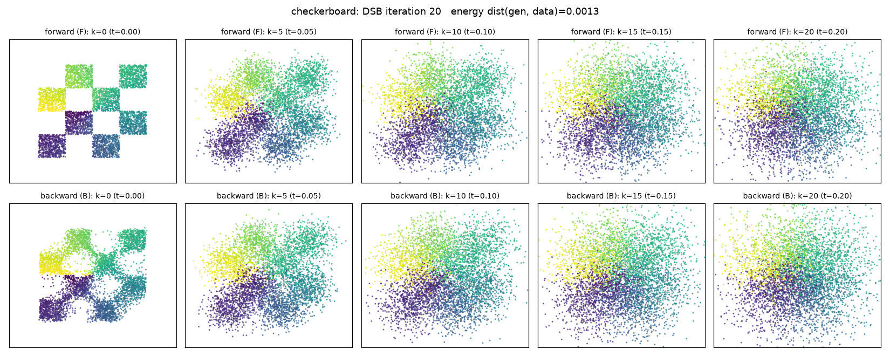 | 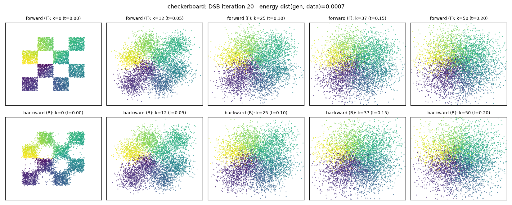 |

### 3. CIFAR-10

Configuration (Appendix J.2, CelebA settings, d = 32·32·3 = 3072): `p_prior = N(0, I)`, OU reference
towards the prior, symmetric γ schedule with γ_min = 1e-5 and γ_max = 0.1, reduced U-Net with
64 channels (8.95 M parameters per network, attention at 16×16), Adam 1e-4, EMA 0.999, batch 128,
unweighted mean-matching loss.  The first (SGM-like) backward half-step uses closed-form
reference sampling for 20 000 steps; every further half-step trains for 10 000 steps on a cache
of 512 trajectories refreshed every 400 steps (≈ 2 passes over the cache for N = 50); 12 DSB iterations.
One A100 runs at ~15 it/s (closed-form phase) and 12-15 it/s (cached phases, N = 50); a full run
takes about 6 hours.  Six runs (Slurm ids in `logs/jobids.txt`, exact commands in
`slurm/overnight.sh` and the git history):

| run | N | γ ramp | T = Σγ | reference endpoint `X_N ≈ A X_0 + S Z` |
|---|---|---|---|---|
| `cifar10_N50` | 50 | linear (paper)¹ | 2.40 | A = 0.08, S = 1.01 |
| `cifar10_N20` | 20 | linear (paper)¹ | 0.90 | A = 0.39, S = 0.93 |
| `cifar10_N50q` | 50 | quadratic¹ | 1.57 | A = 0.20, S = 0.99 |
| `cifar10_N20q` | 20 | quadratic¹ | 0.57 | A = 0.56, S = 0.84 |
| `cifar10_big_N50q` (6 GPUs, 128 ch) | 50 | quadratic | 1.70 | A = 0.17, S = 1.00 |
| `cifar10_big_N50geo` (6 GPUs, 128 ch) | 50 | geometric | 0.63 | A = 0.52, S = 0.87 |

¹ These four runs were launched before the ramp was corrected to reach γ_max (commit e12e644):
they used u_k = 2k/N for k < N/2, so their largest step is 0.096 instead of 0.1 and their horizons
are 2.40 / 0.90 / 1.57 / 0.57 instead of the 2.50 / 1.00 / 1.70 / 0.70 the same flags give today.
Their `config.json` files carry `gamma_legacy_ramp: true`, so `scripts/sample.py` and the driver
reproduce their exact schedule (`symmetric_gammas(..., legacy=True)`).

The two 6-GPU runs use the full-size Nichol & Dhariwal U-Net (128 channels, 35.7M parameters
per network), global batch 768, Adam 2e-4 with 1 000 warm-up steps, 8 000 steps per half-step
and a cache of 3 072 trajectories.  `big_N50geo` uses the geometric ramp
`geomspace(1e-5, 0.1, 25)` mirrored, whose horizon T = 0.63 is exactly the one quoted in
Figure 4 of the paper for its N = 50 CelebA model (the linear ramp of Appendix J.2 gives
T = 2.5, which contradicts that figure, whereas a geometric ramp between the same γ_0 and γ̄
gives exactly 0.63).  With
T = 0.63 the reference chain leaves 52 % of the image in X_N, so the first (SGM) iteration is
poor by construction and everything beyond it is the Schrödinger-bridge correction.  The first
four runs (small U-Net, one GPU each) predate the multi-GPU driver and the reference-residual
parametrisation of the forward network; the two big runs use both.

**A finding about the paper's schedule.**  With the linear ramp the two smallest steps are
γ_0 = 1e-5 and γ_1 ≈ 4e-3 (N = 50).  In the backward chain the noise `sqrt(2γ_1) ≈ 0.09`
injected at the second-to-last step is 20× larger than the noise level (`sqrt(2γ_0) ≈ 0.0045`)
that the near-identity last mean map B(1, ·) ever sees during training, so it is never removed
and the samples of every DSB iteration carry pixel speckle of that amplitude (mean absolute
neighbouring-pixel difference of the samples after the first iteration: 27 gray levels for
N = 50 and 34 for N = 20 versus 14 for real images).  Later IPF iterations cannot fix this: the
kernels have fixed variance 2γ_k and the small-step maps stay near the identity on both sides.
Starting the ramp quadratically (`--gamma-power 2`, γ_1 ≈ 1.7e-4 in these runs, 1.8e-4 with the
corrected ramp) removes most of the speckle
(21.5 gray levels for N = 50) at the price of a shorter horizon, which is exactly the regime DSB
is designed for.

**Implementation notes.**
* Sampling uses the noise-free last step X_0 = B(1, X_1) (as the authors' code does); with
  γ_0 = 1e-5 the omitted noise has standard deviation 0.0045.
* The forward network is parametrised as F(k, x) = x + γ_k f(x) + net(k, x) with the reference
  drift f as a fixed residual (`ReferenceResidual`), so that the untrained network is exactly the
  reference dynamics F^0 (Technique 5 at n = 0).  The four single-GPU runs predate this change
  and started the forward network from the identity map instead (their `forward_iter000.png`
  therefore shows a plain random walk, not the reference chain); the 6-GPU runs use it.
* Two typos in the paper are *not* reproduced: eq. (97) has the sign of F_k(X_k) − F_k(X_{k+1})
  flipped relative to eq. (12) and Appendix E.1, and Algorithm 3 line 11 writes √(2γ_{k+1})
  where Algorithm 1 line 8 has √(2γ_k).  The code follows (12) and Algorithm 1; an IPF run with
  exact regressors on the code's cached targets converges to the analytic Gaussian bridge, and
  diverges if the sign is flipped.
* FID uses 5 000 generated samples against the statistics of the 50 000 training images
  (pytorch-fid Inception weights).  With 5 000 samples FID is biased upwards by roughly 10 points
  relative to the usual 50k/50k protocol, so values are comparable within this repository only.

**FID (5 000 samples) per DSB iteration.**  Iteration 1 is the classical score-based model
obtained from the first backward half-step; every further row is one more IPF iteration.  The
table is regenerated by `scripts/plot_results.py` (`figures/fid_table.md`).  All runs are
complete.

| DSB iteration | N20 | N20q | N50 | N50q | big_N100q | big_N50geo | big_N50q |
|---|---|---|---|---|---|---|---|
| 1 | 309.0 | 271.0 | 188.5 | 137.3 | 63.0 | 185.9 | 113.4 |
| 2 | 280.1 | 243.9 | 157.0 | 119.4 | 46.8 | 153.6 | 70.8 |
| 3 | 262.2 | 233.3 | 155.7 | 124.2 | 45.6 | 153.4 | 69.3 |
| 4 | 259.1 | 232.2 | 154.5 | 125.2 | 46.0 | 137.6 | 67.8 |
| 5 | 243.1 | 215.6 | 153.8 | 116.0 | 46.0 | 140.5 | 69.1 |
| 6 | 236.8 | 214.6 | 151.4 | 119.8 | 44.7 | 135.8 | 68.1 |
| 7 | 228.8 | 205.1 | 153.1 | 118.9 | 43.4 | 139.9 | 70.1 |
| 8 | 229.0 | 200.9 | 150.6 | 120.2 | 43.5 | 132.2 | 71.3 |
| 9 | 222.9 | 194.0 | 150.3 |  | 46.1 | 127.5 | 68.4 |
| 10 | 225.0 |  | 155.2 |  | 45.4 | 122.5 | 67.2 |
| 11 | 217.0 |  |  |  | 45.7 | 117.9 | 66.3 |
| 12 | 210.2 |  |  |  | 45.8 | 112.1 | 69.8 |

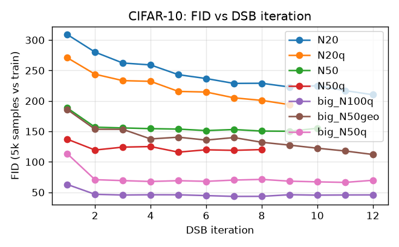

What the numbers show:

* **IPF iterations improve every configuration**, most strongly when the horizon is short and
  the first iteration is therefore far from a valid generative model: N = 20 (T = 0.9) goes from
  309 to 210, N = 20 quadratic (T = 0.57) from 271 to 194, while the long-horizon N = 50 run
  (T = 2.4, already close to the SGM regime) only moves from 188 to ~150.  This is the
  qualitative behaviour of Figure 6 of the paper.
* **The γ ramp matters more than anything else at fixed compute**: the quadratic ramp beats
  the paper's linear ramp by 50 FID points after the first iteration at N = 50 (137 vs 188) and
  by about 30 points later on (119 vs 157 after two, ~118 vs ~150 after eight), because of the
  last-step speckle explained above.
* **Compute, model size and discretisation**: the 36M-parameter network trained on 6 GPUs
  reaches FID 113 after the first half-step and **71 after the first full DSB iteration**
  (N = 50), then plateaus at 66-70.  Doubling the number of steps to **N = 100** (same horizon,
  30k-step first half-step) gives 63 after the first half-step and **43-46 after two or more
  DSB iterations** — the best result of this project, obtained in 7 hours on 6 A100s.  In both
  big runs the second half-step is the single largest improvement, i.e. the bridge correction
  pays off most when the networks have the capacity to represent it.
* **The paper's own regime (`big_N50geo`, T = 0.63)** behaves differently: the reference chain
  leaves half of the image in X_N, the first (SGM) iteration is poor (FID 186), and IPF then
  improves the model almost monotonically over all 12 iterations, 186 → 154 → 138 → 132 → 122 → 112,
  still falling at the end.  This is the Schrödinger-bridge mechanism the paper advertises — a
  too-short forward process repaired by IPF — and, at equal compute, it is also the reason to
  prefer a horizon where the reference already comes close to the prior: the N = 50 quadratic run
  with T = 1.7 plateaus at 66-70 after two iterations.
* The gain per iteration flattens after 2-8 iterations when the horizon is long; the paper's
  Figure 6 shows the same saturation.  Further progress would come from more steps N and longer
  half-steps rather than from more IPF iterations.

Samples (64 random draws, no cherry-picking).  Top: the paper's linear ramp, N = 20, after 1 and
12 DSB iterations — the IPF iterations turn colour noise into image-like structure, but the
speckle from the schedule largely remains (the neighbouring-pixel metric falls by only 15-20 %).  Bottom: quadratic ramp, N = 50, after 1 and 9 iterations, and
the 36M-parameter N = 50 model after 12 iterations.

| `N20` iter 1 | `N20` iter 12 |
|---|---|
| 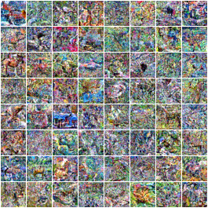 | 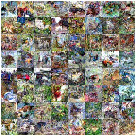 |

| `N50q` iter 1 | `N50q` iter 9 | `big_N50q` iter 12 |
|---|---|---|
| 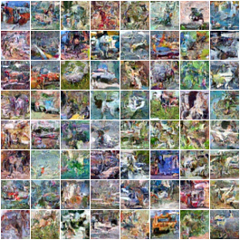 | 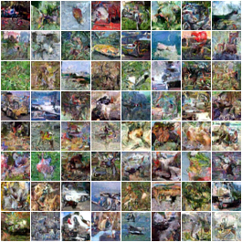 | 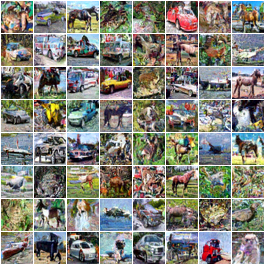 |

The best model, `big_N100q` (N = 100, 36M parameters), after its first half-step (FID 63) and after
12 DSB iterations (FID 46; best 43.4 at iteration 7):

| `big_N100q` iter 1 | `big_N100q` iter 12 |
|---|---|
| 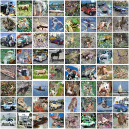 | 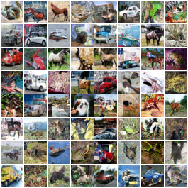 |

The paper's short-horizon regime, `big_N50geo` (T = 0.63): after the first half-step (FID 186)
the samples are fragmented textures; after 12 DSB iterations (FID 112) objects and scenes emerge,
though noisier than with the longer horizon:

| `big_N50geo` iter 1 | `big_N50geo` iter 12 |
|---|---|
| 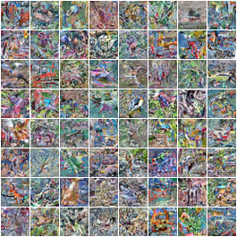 | 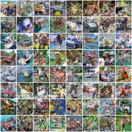 |

Trajectory strips (`figures/*_trajectory_*.png`, rows k = N, 3N/4, N/2, N/4, 0) show the backward
chain from Gaussian noise to a sample, and `figures/*_forward_*.png` the learnt forward chain
from data to the prior.  The forward-endpoint diagnostics below confirm the mechanism of DSB:
after the first forward half-step the learnt forward chain maps the data to a distribution with
unit standard deviation and kurtosis 3 (Gaussian) even when the reference chain does not reach
the prior (the iteration-1 point of the four single-GPU runs is the untrained identity map, see
the implementation notes).

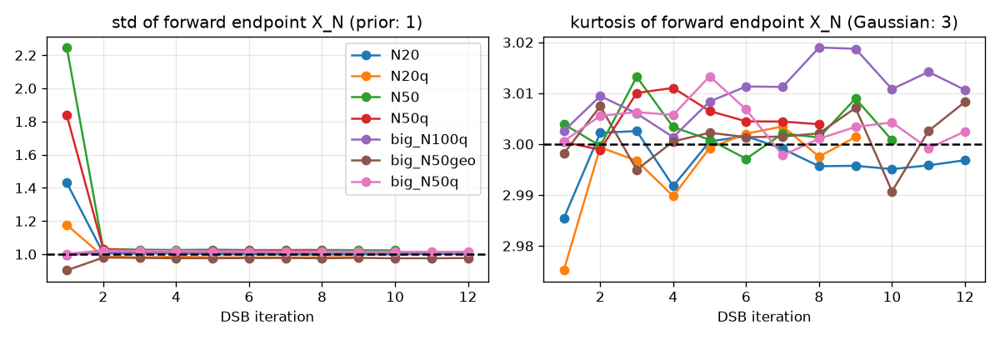

### Status

All runs are complete (2026-09-16 05:50 UTC): Gaussian check, toys and toy sweep, the four
single-GPU CIFAR runs (`N20` all 12 iterations; `N50`, `N50q`, `N20q` stopped after 10, 8 and 8
once their FID curves had flattened), and the three big runs `big_N50q` (12 iterations, 6 GPUs,
10.5 h), `big_N100q` (12 iterations, 6 GPUs, 7 h) and `big_N50geo` (12 iterations; 6 GPUs for the
first two, then 8 GPUs of `lambda-hyperplane0` for the rest after a 2-GPU resume attempt hung in
the NCCL clique set-up for its whole allocation, `logs/cifar_big_geo_525234.err`).

To refresh tables and figures after further runs:

```bash
.venv/bin/python scripts/plot_results.py        # figures/, figures/fid_table.md, figures/toy_sweep_table.md
.venv/bin/python scripts/sample.py runs/cifar10_big_N100q --n 64          # samples from the latest checkpoint
.venv/bin/python scripts/sample.py runs/cifar10_big_N100q --interpolate   # latent interpolation (Fig. 13)
```

Unit tests: `python -m pytest tests -q` (CPU, ~10 s).
